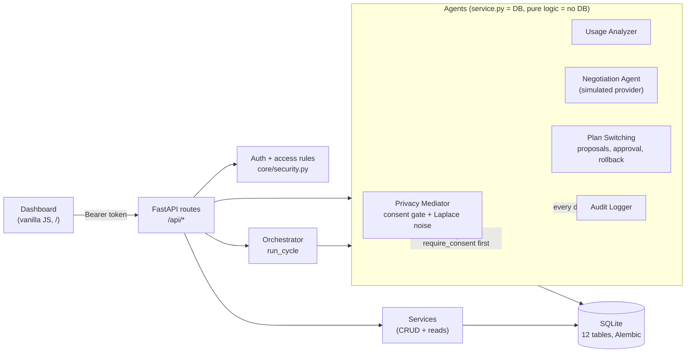
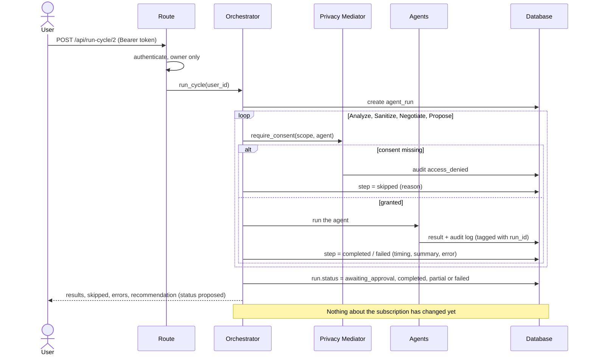
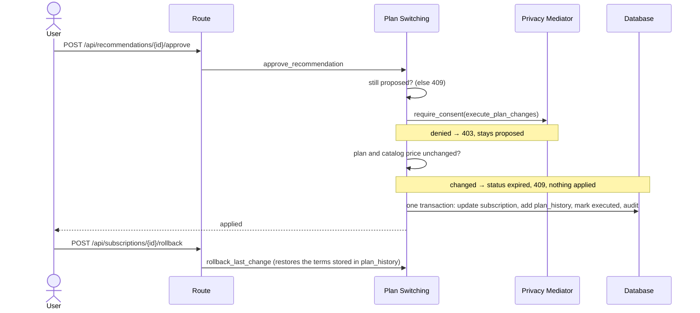

<p align="center">
  <h1 align="center">🤖 Agentic Digital Twin</h1>
  <p align="center">
    An autonomous AI agent that manages telecom &amp; digital subscriptions —<br/>
    analyzing usage, negotiating prices, switching plans, and explaining every decision.
  </p>
</p>

<p align="center">
  
  
  
  
  
</p>

---

## 📋 Overview

**Agentic Digital Twin** is an intelligent backend system that acts as a user's autonomous representative for managing subscriptions (Jio, Airtel, Netflix, AWS, etc.).

It analyzes usage patterns, protects user privacy (consent gates + differential privacy), negotiates prices against a **built-in provider simulator**, validates proposed changes against KPIs and SLA risk, and keeps an explainable audit trail of every decision. Consequential changes are **proposed, not applied**: the user approves or rejects each one.

> **Simulation notice:** there are no real provider integrations. Negotiation outcomes come from a simulator and are labelled `simulated: true`; the plan catalog is demo data.

### 🎯 Key Highlights

- **Orchestrated decision cycle** — one endpoint runs every agent; each run and step is recorded
- **Human in the loop** — plan changes wait for the user's approval and can be rolled back
- **Modular architecture** — every module has a clean separation of pure logic vs DB persistence
- **Privacy-first** — every agent passes a consent gate; Laplace noise is applied before any data is shared
- **Explainable AI** — every decision generates a human-readable, deterministic audit message
- **Safe plan switching** — KPI validation + SLA risk assessment + atomic apply and rollback

---

## ✨ Features

### 1. 📊 Usage Analyzer
Measures every active subscription from its actual usage records (rule-based, deterministic).

- Utilisation of **data and call minutes**; the higher one is the binding constraint
- Average and **peak** usage, month-over-month **trend** and next-month **projection**
- **Overage** actually billed above the plan price (since the last price change)
- Categories: `underutilized` / `optimal` / `overutilized`; a downgrade is held back when usage is rising toward the threshold; plans with no cap are `no_metric`
- `unused_spend`: what you pay for capacity you don't use — an indicator, *not* a saving
- Confidence from history length (full at 6 periods) and usage stability
- Picks the subscription with the most ₹/month at stake (unused spend, or overage)

### 2. 🔒 Privacy-Preserving Mediator
Applies differential privacy (Laplace mechanism) to sanitize sensitive usage data before processing.

- Controlled Laplace noise on `data_used_gb` and `call_minutes_used`
- Configurable noise scale (β parameter)
- Zero-clamping to prevent negative values
- Raw data never leaves the privacy boundary

### 3. 🤝 Negotiation Agent (simulated provider)
Multi-round price negotiation against a **built-in provider simulator** — there is no real provider.

- **Walk-away price**: never agrees to pay more than 95% of today's price, or more than the best catalog alternative costs (the user's BATNA)
- Strategy adapts to utilisation; deal when within 3% and at or below the walk-away price
- **Reproducible**: seeded per subscription and session, so every outcome can be replayed
- Runs only for underutilized plans; full round history persisted

### 4. 🔄 Plan Switching with Approval and Rollback
Compares the negotiated price with the best **catalog alternative** and **proposes** the bigger saving.

- **Alternatives**: catalog plans must cover peak/projected usage + 10% headroom and respect the user's preferences (budget, minimum data/minutes, required features, provider rules); every excluded plan comes with its reasons (`GET /api/subscriptions/{id}/alternatives`)
- **Savings** are measured against the effective current cost (price + average overage), so a bigger plan can be the cheaper option
- **Explanation** on every proposal: what, why, benefits, drawbacks, and the usage data used
- **Cost validation**: downgrade must save ≥ 5%; paying the same or more needs more capacity
- **SLA risk**: low / medium / high based on data + call limit proximity
- **Approval**: a recommendation is applied only when the user approves it (needs `execute_plan_changes` consent); it expires if the plan changed in the meantime
- **History & rollback**: every applied change is recorded in `plan_history` and can be rolled back

### 5. 📝 Explainable Audit Logger
Generates deterministic, human-readable explanations for every decision the system makes.

- Action-specific formatters for analysis, negotiation, and switching
- Immutable audit trail with JSON detail payloads
- Paginated retrieval by user
- Module attribution for traceability

### 6. ⚡ Orchestrator
`app/orchestrator/pipeline.py` runs one decision cycle per call.

- Order: Analyze → Sanitize → Negotiate → Propose; every agent audits its own decision
- Privacy Mediator gate: a missing consent **skips** that agent (and the steps that need it) and is audited as `access_denied`
- No repeat negotiation while a proposal for that subscription awaits a decision
- Every run and step (status, timing, summary, error) is stored and served at `/api/runs/{run_id}`
- A failing agent is rolled back and recorded; independent steps still run
- Final status: `awaiting_approval` / `completed` / `partial` / `failed`

### 7. 🖥 Dashboard
Vanilla-JS dashboard served at `/` (sign in first). Every panel reads a real API endpoint.

- **Dashboard** — subscriptions, proposals awaiting approval, approved savings, last agent run
- **Approvals** — each proposal with what/why/benefits/drawbacks, the evidence behind it, approve/reject, decision history
- **Plans & Alternatives** — required capacity, every catalog plan as *fits* or *ruled out (reason)*, change history with undo
- **Privacy Center** — grant/revoke each permission, edit preferences, recent consent and access-denied events
- **Agent Activity** — per-agent status from recorded steps, and every run with its steps, timings and errors
- Admins see other users' pages read-only; works down to phone width (375px)

---

## 🏗 Architecture

### Components



### One decision cycle (`POST /api/run-cycle/{user_id}`)



A failing agent is rolled back and recorded; the steps that do not depend on it still run.

### Approval and rollback



### What is real, simulated, and planned

| Capability | Status | Notes |
|---|---|---|
| Usage analysis | **Real, rule-based** | Computed from stored usage records. No machine learning. |
| Consent gate, audit trail, approvals, rollback | **Real** | Enforced in the service layer; every agent passes the gate. |
| Differential privacy | **Real, basic** | Laplace noise per call. There is no privacy-budget accounting. |
| Plan catalog | **Demo data** | Seeded, `source: "demo_seed"`; not live provider pricing. |
| Provider negotiation | **Simulated** | A seeded simulator, labelled `simulated: true`. No provider is contacted. |
| Applying a plan change | **Updates the twin's own records only** | Approval changes the subscription row in this database; nothing is sent to a provider. |
| Real provider APIs, ML analysis, RL negotiation | **Planned** | See *Future Enhancements*. |

---

## 🛠 Tech Stack

| Layer | Technology |
|-------|-----------|
| **Language** | Python 3.12 (the version the tests were run on) |
| **Web Framework** | FastAPI |
| **ORM** | SQLAlchemy 2.1 |
| **Database** | SQLite (PostgreSQL untested) |
| **Validation** | Pydantic v2 |
| **Server** | Uvicorn (ASGI) |
| **Migrations** | Alembic |
| **Auth** | Bearer tokens (JWT via PyJWT), scrypt password hashing (stdlib) |
| **Testing** | pytest + FastAPI TestClient; `test_integration.py` smoke script (stdlib `urllib`) |

---

## 📁 Project Structure

```
digital-agentic-twin/
├── app/
│   ├── __init__.py
│   ├── main.py                  # FastAPI app entry point
│   ├── config.py                # Centralized configuration
│   ├── database.py              # SQLAlchemy engine, session, Base
│   ├── models.py                # ORM models (12 tables)
│   ├── db_migrations.py         # Runs Alembic migrations on startup
│   ├── schemas.py               # Pydantic request/response schemas
│   │
│   ├── api/
│   │   └── routes.py            # All REST endpoints (thin layer)
│   │
│   ├── modules/
│   │   ├── usage_analyzer/
│   │   │   ├── analyzer.py      # Pure analysis logic (stateless)
│   │   │   └── service.py       # DB orchestration
│   │   │
│   │   ├── privacy_mediator/
│   │   │   ├── sanitizer.py     # Pure Laplace noise logic (stateless)
│   │   │   └── service.py       # DB orchestration
│   │   │
│   │   ├── negotiation_agent/
│   │   │   ├── engine.py        # Pure negotiation logic (stateless)
│   │   │   └── service.py       # DB orchestration
│   │   │
│   │   ├── plan_switching/
│   │   │   ├── executor.py      # Pure KPI validation (stateless)
│   │   │   └── service.py       # DB orchestration + rollback
│   │   │
│   │   └── audit_logger/
│   │       ├── formatter.py     # Pure message generation (stateless)
│   │       └── service.py       # DB persistence
│   │
│   ├── services/
│   │   ├── base_service.py      # Reusable DB helpers (save, transactional)
│   │   ├── user_service.py      # User CRUD
│   │   ├── subscription_service.py  # Subscription + usage CRUD
│   │   ├── catalog_service.py   # Plan catalog reads
│   │   ├── recommendation_service.py / run_service.py  # Proposal + run history reads
│   │
│   ├── core/                    # Auth tokens, passwords, access rules, rate limit, logging
│   │
│   ├── orchestrator/
│   │   └── pipeline.py          # Decision cycle, run + step recording
│   │
│   └── utils/
│       └── seed_data.py         # Database seeding utility
│
├── frontend/                    # Dashboard (index.html, script.js, styles.css; no build step)
├── migrations/versions/         # Alembic schema migrations
├── tests/                       # pytest suite
├── seed_data.py                 # Convenience CLI for seeding
├── demo.py                      # Scripted walk-through against a running server
├── test_integration.py          # Smoke script for a live server
├── Dockerfile / .dockerignore
├── requirements.txt / requirements-dev.txt
└── README.md
```

### Architecture Principle

Every module follows a strict **two-layer separation**:

| File | Role | Rules |
|------|------|-------|
| `analyzer.py` / `engine.py` / `executor.py` / `sanitizer.py` / `formatter.py` | **Pure logic** | No DB, no framework imports, stateless, easily testable |
| `service.py` | **DB orchestration** | Fetches data, calls pure logic, persists results |

---

## 🔌 API Endpoints

All endpoints are prefixed with `/api`. Every endpoint except register/login needs
`Authorization: Bearer <token>` (in Swagger, use **Authorize**). Responses follow a uniform envelope:

```json
// Success
{ "status": "success", "data": { ... } }

// Error (401 not signed in, 403 consent/admin, 404 not found, 409 conflict, 422 validation, 429 rate limit)
{ "status": "error", "message": "..." }
```

The pipeline acts on a single **optimization target**: the most underutilized active
subscription. Negotiation and switching both run against it. When no subscription is
underutilized they are skipped (`"skipped"` in the response). A switch is only ever
*proposed* for a price the provider **accepted**, never for a higher price at the same capacity.

### Authentication & Access

| Method | Endpoint | Description |
|--------|----------|-------------|
| `POST` | `/api/auth/register` | Create an account (role `user`) and get a token |
| `POST` | `/api/auth/login` | Email + password → token (rate limited) |
| `GET` | `/api/auth/me` | The signed-in user |

- **Users reach only their own data.** Another user's records answer 404, so they can't be probed.
- **Admins can read** any user's data but **cannot act for them** — consents, preferences, usage,
  agent runs and approvals are the owner's alone (403).
- Passwords are stored as salted scrypt hashes; tokens expire after `ACCESS_TOKEN_MINUTES` (60).
- Account creation, sign-ins, and failed sign-ins against a real account are written to that user's audit log (action `sign_in`); failures for unknown emails are not recorded.

### Core Data

| Method | Endpoint | Description |
|--------|----------|-------------|
| `POST` | `/api/users` | Create an account (admin only; users sign up via `/auth/register`) |
| `GET` | `/api/users` | List all users (admin only, paginated) |
| `GET` | `/api/users/{user_id}` | Get a user by ID |
| `POST` | `/api/subscriptions` | Create a subscription |
| `GET` | `/api/subscriptions/user/{user_id}` | List user's subscriptions |
| `GET` | `/api/subscriptions/{sub_id}` | Get a subscription by ID |
| `POST` | `/api/usage` | Ingest a usage record (linked to the user's subscription with that provider, or an explicit `subscription_id`) |
| `GET` | `/api/usage/user/{user_id}` | List user's usage records |
| `GET` | `/api/subscriptions/{sub_id}/history` | Every applied change to a subscription |
| `GET` | `/api/subscriptions/{sub_id}/alternatives` | Catalog plans that fit, best saving first, and why the rest don't (consent: `usage_analysis`) |
| `GET` / `PUT` | `/api/users/{user_id}/preferences` | Budget, minimum data/minutes, required features, provider rules |
| `GET` | `/api/users/{user_id}/consents` | Every consent scope and whether it is granted (default: denied) |
| `PUT` | `/api/users/{user_id}/consents/{scope}` | Grant or revoke one scope (audited) |
| `GET` | `/health` | Liveness + database check (no token; outside `/api`) |
| `GET` | `/api/plans` | Plan catalog, cheapest first (`?provider=`, `?category=`) |

> The seeded catalog is **demo data** (`source: "demo_seed"`), not live provider pricing.
> Consents are enforced by every agent (default: denied). Preferences constrain which catalog plans are recommended.

### Intelligent Modules

| Method | Endpoint | Description |
|--------|----------|-------------|
| `POST` | `/api/analyze/{user_id}` | Run usage analysis (consent: `usage_analysis`) |
| `POST` | `/api/sanitize/{user_id}` | Get sanitized (private) usage data (consent: `share_usage_with_provider`) |
| `POST` | `/api/negotiate/{user_id}` | Simulated price negotiation (consents: all three above) |
| `POST` | `/api/switch/{user_id}` | Evaluate the latest deal and **propose** a change (nothing is applied) |
| `GET` | `/api/recommendations/user/{user_id}` | List proposals (`?status=proposed`) |
| `GET` | `/api/recommendations/{id}` | One proposal with rationale and evidence |
| `POST` | `/api/recommendations/{id}/approve` | Apply it (consent: `execute_plan_changes`) |
| `POST` | `/api/recommendations/{id}/reject` | Reject it; nothing changes |
| `POST` | `/api/subscriptions/{sub_id}/rollback` | Undo the last applied change (consent: `execute_plan_changes`) |
| `GET` | `/api/audit/{user_id}` | Get explainable audit logs |
| `GET` | `/api/audit/user/{user_id}` | Get audit logs (alternate) |
| `GET` | `/api/negotiation/{sub_id}/history` | Get negotiation round history |

### Unified Pipeline

| Method | Endpoint | Description |
|--------|----------|-------------|
| `POST` | `/api/run-cycle/{user_id}` | **Run one decision cycle** (analyze → sanitize → negotiate → propose) |
| `GET` | `/api/runs/user/{user_id}` | A user's runs with their steps |
| `GET` | `/api/runs/{run_id}` | One run: each agent's status, timing, summary, error |

---

## 🚀 How to Run

### Prerequisites

- Python 3.12 (other versions are untested)
- pip

### 1. Clone the repository

```bash
git clone https://github.com/your-username/agentic-digital-twin.git
cd agentic-digital-twin
```

### 2. Create a virtual environment (recommended)

```bash
python -m venv venv
# Windows
venv\Scripts\activate
# macOS/Linux
source venv/bin/activate
```

### 3. Install dependencies

```bash
pip install -r requirements.txt
```

### 4. Seed the database with demo data

```bash
python seed_data.py --reset
```

This creates the demo plan catalog, 5 users with subscriptions and usage history, full
consent for the demo users, and a read-only admin. The data is generated from a fixed seed
(`--random-seed`, default 42), so every reset builds the same dataset.

**Demo sign-in** (local demos only): any seeded email such as `priya.patel@example.com`, or
`admin@example.com`, with the password `demo-pass-2026` (override with `DEMO_PASSWORD` before seeding).
A database from an older version keeps its users but they have no password; reseed to use the demo.

### 5. Start the server

```bash
uvicorn app.main:app --reload
```

The dashboard and API are now live at **http://127.0.0.1:8000** — sign in with a demo account.

| Setting | Default | Notes |
|---------|---------|-------|
| `SECRET_KEY` | random per process (DEBUG only) | **Required** when `DEBUG=false`; without it tokens stop working on restart |
| `ACCESS_TOKEN_MINUTES` | `60` | Token lifetime |
| `CORS_ORIGINS` | `http://127.0.0.1:8000,http://localhost:8000` | Other browser origins allowed to call the API |
| `RATE_LIMIT_PER_MINUTE` | `120` | Per client IP; `0` disables |
| `LOGIN_RATE_LIMIT_PER_MINUTE` | `10` | Login/register, per client IP |
| `REJECTION_COOLDOWN_DAYS` | `30` | A rejected proposal is not offered again with identical terms for this long (`0` disables) |

The rate limiter is in memory (per process); a multi-process deployment needs a shared store.

### 6. Explore the interactive docs

Open your browser and navigate to:

- **Swagger UI** → [http://127.0.0.1:8000/docs](http://127.0.0.1:8000/docs)
- **ReDoc** → [http://127.0.0.1:8000/redoc](http://127.0.0.1:8000/redoc)

### 7. Run the tests

```bash
pip install -r requirements-dev.txt
pytest
```

The suite uses a throwaway SQLite database and needs no running server.
`test_integration.py` is an older smoke script that runs against a live server
(`python test_integration.py` with uvicorn running).

### 8. Run with Docker

The image runs as an unprivileged user with one Uvicorn worker, and keeps the
SQLite database on a volume at `/data`. `SECRET_KEY` has no default: the container
refuses to start without one.

```bash
docker build -t digital-twin .
docker run -d --name twin -p 8000:8000 -v twin-data:/data \
  -e SECRET_KEY="$(python -c 'import secrets; print(secrets.token_urlsafe(48))')" digital-twin
```

Migrations run at startup. To load the demo data (local demos only — it creates
accounts with a shared, published password):

```bash
docker exec twin python seed_data.py --reset
```

`GET /health` answers 200 when the database is reachable (503 otherwise) and is
what the image's `HEALTHCHECK` calls. It needs no token.

> The Dockerfile has not been built in the environment this README was written in
> (no Docker daemon was running), so treat the first build as untested.

---

## 📡 Example API Calls

### Sign In

```bash
curl -X POST http://127.0.0.1:8000/api/auth/login \
  -H "Content-Type: application/json" \
  -d '{"email": "priya.patel@example.com", "password": "demo-pass-2026"}'
```

Copy `data.access_token` from the response and send it with every call below:
`-H "Authorization: Bearer <token>"`. The examples omit that header for brevity, and act on
your own user id (Priya is user 2 in the seeded data).

### Run the Full Pipeline (Single Click)

```bash
curl -X POST http://127.0.0.1:8000/api/run-cycle/2 -H "Authorization: Bearer <token>"
```

**Response** (abridged):
```json
{
  "status": "success",
  "data": {
    "run_id": 1,
    "user_id": 2,
    "analysis": { "recommendation": "downgrade", "efficiency": 0.195, "binding_metric": "calls", "optimization_target": { "subscription_id": 4 } },
    "sanitization": { "sanitized_usage": [] },
    "negotiation": { "status": "final", "reservation_price": 449.0, "best_alternative": { "plan_name": "Hero 449" }, "simulated": true },
    "switching": { "proposed": true, "action": "switch_plan", "recommendation_id": 1, "proposed_plan": { "plan_name": "Hero 449" }, "risk_flag": "low" },
    "recommendation": { "recommendation_id": 1, "action": "switch_plan", "current_cost": 599.0, "projected_cost": 449.0, "estimated_monthly_savings": 150.0, "explanation": { "what": "Switch from Vi Max 599 to Vi Hero 449 at ₹449.0/month.", "benefits": ["..."], "drawbacks": ["..."] } },
    "audit_logged": ["analysis", "negotiation", "switching"],
    "skipped": null,
    "errors": null,
    "final_status": "awaiting_approval"
  }
}
```

### Analyze Usage

```bash
curl -X POST http://127.0.0.1:8000/api/analyze/2
```

### Negotiate a Better Price

```bash
curl -X POST http://127.0.0.1:8000/api/negotiate/2
```

### Propose a Switch, then Decide

```bash
curl -X POST http://127.0.0.1:8000/api/switch/2
curl -X POST http://127.0.0.1:8000/api/recommendations/2/approve   # or /reject
```

### Get Privacy-Sanitized Data

```bash
curl -X POST http://127.0.0.1:8000/api/sanitize/2
```

### View Audit Trail

```bash
curl http://127.0.0.1:8000/api/audit/2
```

### Register an Account

```bash
curl -X POST http://127.0.0.1:8000/api/auth/register \
  -H "Content-Type: application/json" \
  -d '{"name": "John Doe", "email": "john@example.com", "password": "choose-a-long-one"}'
```

New accounts start with every consent denied — grant them with
`PUT /api/users/{id}/consents/{scope}` before running the agents.

### Create a Subscription

```bash
curl -X POST http://127.0.0.1:8000/api/subscriptions \
  -H "Content-Type: application/json" \
  -d '{
    "user_id": 1,
    "provider": "Jio",
    "plan_name": "Gold 599",
    "monthly_cost": 599.0,
    "data_limit_gb": 100.0,
    "call_minutes_limit": 500
  }'
```

### Ingest Usage Data

```bash
curl -X POST http://127.0.0.1:8000/api/usage \
  -H "Content-Type: application/json" \
  -d '{
    "user_id": 1,
    "provider": "Jio",
    "period_start": "2026-01-01T00:00:00",
    "period_end": "2026-01-31T23:59:59",
    "data_used_gb": 35.5,
    "call_minutes_used": 120,
    "billing_amount": 599.0
  }'
```

---

## 🗄 Database Schema

| Table | Purpose | Key relationships |
|-------|---------|-------------------|
| `users` | Registered users | — |
| `subscriptions` | A user's current plan and terms | `user_id` → users, `catalog_plan_id` → plan_catalog |
| `usage_data` | Per-period consumption | `user_id` → users, `subscription_id` → subscriptions |
| `negotiation_history` | One row per negotiation round | `subscription_id` → subscriptions |
| `audit_logs` | Plain-English record of every decision | `user_id` → users, `run_id` → agent_runs |
| `plan_catalog` | Plans providers offer (the alternatives) | unique (`provider`, `plan_name`) |
| `user_preferences` | Budget, minimums, required features (1:1) | `user_id` → users |
| `consents` | Granted scopes; no row = denied | unique (`user_id`, `scope`) |
| `plan_history` | Every applied change, with before/after terms | `subscription_id`, `recommendation_id` |
| `agent_runs`, `agent_run_steps` | Orchestrator runs and per-agent steps | `user_id`, `run_id` |
| `recommendations` | Proposed actions and their approval status | `user_id`, `subscription_id`, `run_id`, `proposed_plan_id` |

SQLite foreign keys are enforced, so deleting a user cascades to their data.

### Migrations

The schema is managed by Alembic (`migrations/versions/`). The app upgrades the
database to the latest revision on startup. A database created by an older
version of the app (no `alembic_version` table) is recognised, stamped at the
baseline, and upgraded in place, keeping its data.

```bash
alembic upgrade head                                   # apply migrations manually
alembic revision --autogenerate -m "describe change"   # after editing app/models.py
```

---

## 🛡 Production Readiness

### Before exposing this to real users

- [ ] Set a strong `SECRET_KEY` and `DEBUG=false` (the app will not start otherwise).
- [ ] Put it behind a TLS-terminating proxy; the app sets no HSTS/CSP headers itself.
- [ ] Set `CORS_ORIGINS` to the origins that really need it.
- [ ] Do not seed demo data (it has a published password).
- [ ] Back up the SQLite file (or move to a server database — see below) before upgrades; migrations run automatically at startup.
- [ ] Decide whether open self-registration (`POST /api/auth/register`) is acceptable; it has no email verification.
- [ ] Check the `LICENSE` copyright line (it names the repository owner) before publishing.

### Known limitations

These are properties of the code as it stands, not planned behaviour.

**Scope**
- Negotiation is simulated and the catalog is demo data (see the table above). Approving a change does not change anything at a real provider.
- The analyzer is rule-based. Its "savings" are computed from the stored records and the catalog; they are not forecasts of real bills.

**Security and accounts**
- No password reset and no token refresh or revocation (a token is valid until it expires). Failed sign-ins for emails that have no account are logged by the server but not audited per user.
- The dashboard keeps the token in `sessionStorage`, so it is exposed to any script running on the page.
- Rate limiting is in memory and per process: it resets on restart and does not span several workers or instances. Behind a proxy it keys on the address Uvicorn reports, so configure forwarded headers correctly.

**Data**
- Money is stored as floating point (`Float`), not decimals.
- Only SQLite is exercised by the tests and migrations. PostgreSQL has not been tried.
- SQLite allows one writer at a time; it suits a demo or a small single-node deployment.

**Agents**
- After you reject a proposal, the same terms are held back for `REJECTION_COOLDOWN_DAYS`; a different plan or price is still proposed straight away.
- *Agent Activity* shows a run's status as it was when the run finished.
- Laplace noise uses fixed default scales (0.5 GB, 10 minutes) that the API does not expose, and no privacy budget (ε) is tracked.

**Process**
- CI (`.github/workflows/ci.yml`) runs `pytest` and a Docker build with a health check on every push, but it has not run yet: it only starts once the repository is on GitHub.
- `test_integration.py` is a smoke script for a live server, not part of `pytest`.

---

## 🔮 Future Enhancements

| Area | Enhancement |
|------|-------------|
| **ML-Powered Analysis** | Replace rule-based analyzer with a trained model for smarter recommendations |
| **Real Provider APIs** | Integrate with Jio / Airtel / AWS billing APIs for live data ingestion |
| **Reinforcement Learning** | Train the negotiation agent using RL for optimal offer strategies |
| **Stronger Privacy** | Implement ε-differential privacy with formal privacy budgets |
| **Multi-User Scheduling** | Cron-based batch processing to run pipelines for all users periodically |
| **PostgreSQL** | Verify migrations and tests on PostgreSQL for multi-user deployments |
| **Accounts** | Password reset and token refresh/revocation |
| **WebSocket Notifications** | Real-time pipeline progress updates via WebSocket |
| **Usage Charts** | Trend charts on the dashboard (data is already served by the API) |
| **Shared rate limiting** | Redis-backed counters so limits hold across workers |

---

## 📄 License

This project is open-sourced under the [MIT License](LICENSE).

---

<p align="center">
  Built with ❤️ as an Agentic AI demonstration project
</p>
